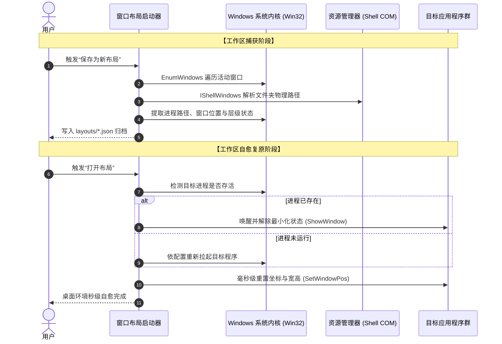

# 窗口布局启动器

<p align="center">
  <strong>专为 Windows 极客与多屏工作流打造的桌面环境记忆与毫秒级自愈复原中枢</strong><br>
  一键捕获全屏窗口 · 资源管理器与浏览器智能复用 · 轻拟态悬浮视觉 · 绿色单文件零常驻
</p>

<p align="center">
  
  
  
  
  
</p>

---

## 🎯 痛点与初衷：为什么需要它？

在多屏幕、宽屏带显示器和高频多任务切换的工作流中，桌面窗口混乱是吞噬专注力的头号元凶：
1. **开机与重连的机械折磨**：每次电脑重启、断开外接显示器、合盖移动后再展开，原本精心编排的十几个窗口散落各处，重新手动拖拽、缩放窗口动辄耗费数分钟；
2. **场景切换的心智负担**：从“全屏开发”切换到“文档撰写”，再到“多路 AI 对话协同”，不同场景需要完全不同的窗口排列，手动调整让人疲惫不堪；
3. **传统分屏工具的短板**：第三方分屏软件体积臃肿、常驻后台占用系统资源，且大多无法真正恢复特定的文件夹路径，遇到最小化或特定浏览器标签更是直接失效。

**窗口布局启动器正是为彻底解决这一工作流断层而设计——以原生轻巧的单文件体积，实现多屏幕、多窗口复杂工作区的一键记忆与毫秒级自愈复原。**

---

## 🌟 四大核心技术支柱

```
┌────────────────────────────────────────────────────────────────────────┐
│                        窗口布局启动器 核心能力矩阵                      │
├──────────────────┬──────────────────┬─────────────────┬────────────────┤
│  ⚡ 原生毫秒复原 │  🧭 智能感知复用 │  🎨 轻拟态悬浮  │  🍃 单文件零常驻│
│  底层 Win32 API  │  文件路径与标签  │  舒适冷灰蓝质感 │  无后台守护进程│
│  捕获坐标与层级  │  优先唤醒存活实例│  高 DPI 完美自适应│  系统编译器直出│
└──────────────────┴──────────────────┴─────────────────┴────────────────┘
```

### 1. ⚡ 原生毫秒级捕获与自愈复原
* **底层系统级接入**：通过原生 Win32 API 高速遍历系统顶层窗口句柄，精准记录多屏相对坐标、窗口长宽、活动层级及窗口状态（正常、最大化、最小化）；
* **死锁与超时防御**：针对无响应或假死窗口设立安全超时屏障，保证还原流程在任何极端场景下都能平稳执行完毕。

### 2. 🧭 现代应用智能感知与深度复用
* **资源管理器物理路径解析**：通过 Windows Shell 接口精确提取文件资源管理器当前打开的真实物理目录，复原时自动重新导航，不再丢失工作目录；
* **浏览器实例精准复用**：针对正在进行特定会话（如 AI 对话、工作台）的 Edge 与 Chrome 窗口进行特征捕获，恢复时优先唤醒并调整已有实例，杜绝无节制重复弹窗；
* **现代沙箱与 UWP 支持**：打通现代应用启动通道，无缝识别与拉起以 Codex 为代表的 UWP 应用。

### 3. 🎨 轻拟态悬浮设计美学
* **告别传统生硬灰框**：全界面采用专属调校的“轻拟态悬浮”设计风格——柔和冷灰蓝底色、浮起式卡片容器、圆角操作键与高辨识度图标；
* **高 DPI 与多分辨率无损呈现**：经过默认尺寸、放大与缩小等不同视窗状态的自绘渲染优化，排版留白呼吸感十足，字号清晰不裁切。

### 4. 🍃 纯粹极简，单文件零常驻
* **不写系统服务，不霸占内存**：用完即关，零后台守护进程，零垃圾注册表残留；
* **纯绿色免安装**：源码仅基于 Windows 系统自带的 .NET Framework 原生运行，单 EXE 双击即用，开箱即享。

---

## 🚀 极简上手流程


### 1. 捕获保存当前工作区
1. 将当前需要协同的文件资源管理器、浏览器、IDE、聊天窗口调整到满意的位置与大小；
2. 双击运行 `窗口布局启动器.exe`；
3. 点击右侧 **“保存为新布局”**，输入具有业务含义的名称（例如：`多屏AI研发工作区`、`日常写作协同`）。

### 2. 毫秒级一键唤醒复原
* 当窗口被打乱、重新插拔显示器或开机后：
* 打开启动器，在左侧卡片列表中选中目标布局，点击 **“打开布局”**；
* 所有关联窗口将在不到一秒内全部自动复原、层级对齐并回到原位！

### 3. 日志与诊断

右侧点击 **“日志与诊断”**，可以在程序内读取最近的恢复日志、崩溃日志和更新日志；日志列表按最近修改时间排序，单个日志过大时会限制预览长度。日志文件保存在程序目录的 `logs/`，可通过查看器底部按钮直接打开。

---

## 📦 便携共享与跨机协同

### 分享与备份单个布局预设
1. 在列表中选中已保存的布局，点击 **“导出 JSON”**；
2. 应用会在同目录下的 `exports/` 文件夹中输出标准化布局定义；
3. 将该 JSON 文件发送给同事或导入到其他工作机，点击 **“导入 JSON”** 即可瞬间载入。

### 共享整个应用
* 直接将包含可执行文件的文件夹整体打包发送即可；
* 应用数据集中存放在 `layouts/` 目录，便于随身携带或同步至云盘。

### 稳定版与开发版

开发维护时使用桌面的 **“窗口布局启动器 - 开发版”**，日常工作使用 **“窗口布局启动器 - 稳定版”**。两套目录和布局数据物理隔离，验证通过后再将开发版提升为稳定版；更新失败时，稳定版会保留带时间戳的 `backups/` 备份。

---

## 🏗️ 架构与数据流拓扑



---

## ❓ 常见问题解答

### Q1: 换了不同分辨率或缩放比例的显示器，布局还能精准生效吗？
Windows 底层坐标以像素为基准。如果你从 4K 屏切换到 1080P 屏，或者更改了系统缩放比例（如 125% 改为 100%），窗口坐标可能会偏出当前可视边界。  
**建议**：在固定的屏幕硬件与缩放比下保存对应布局；更换主要外接显示器后，只需重新摆好并一键覆盖保存即可。

### Q2: 为什么少数特定窗口无法被调整位置？
1. **权限隔离**：如果某个软件以“管理员身份”运行，而启动器是以普通用户权限运行，受 Windows UIPI 安全机制限制，普通权限无法操作高权限窗口。此时只需右键选择“以管理员身份运行”启动器即可解决；
2. **特殊防护软件**：少数拥有自定义防注入或反挂钩机制的专有软件，可能屏蔽常规位置调整指令。

### Q3: 资源管理器在别人电脑上为什么没有自动打开对应文件夹？
布局中记录的文件夹路径为本机的绝对物理路径（例如 `D:\Work\ProjectA`）。如果接收方电脑上不存在完全相同的本地路径，为防止误报，程序不会强行拉起不存在的文件夹，对方只需在自己的机器上保存一份即可。

---

## 🛠️ 源码构建与维护规范

本项目坚守极简工程哲学，无需安装庞大的 Visual Studio 开发套件，使用系统自带组件即可秒级构建：

```powershell
# 克隆仓库
git clone https://github.com/zwmopen/WindowLayoutLauncher.git
cd WindowLayoutLauncher

# 执行自动化构建脚本
.\build.ps1
```

* **编译器**：系统内置 .NET Framework 4.0 64位 C# 编译器 (`csc.exe`)；
* **构建产物**：编译成功后自动输出至 `release/窗口布局启动器.exe`；
* **代码维护**：主代码集中于 [`src/WindowLayoutLauncher.cs`](src/WindowLayoutLauncher.cs)，设计规范遵循轻拟态悬浮标准。

---

## 📄 开源许可

本项目遵循 [MIT 开源许可证](LICENSE)。自由分享，尽情提升效率。

---

## 📝 变更记录

| 日期 (时间) | 执行者 | 记录 |
|---|---|---|
| 2026-09-17 23:11 | 💻 本地 PC / 反重力 | 初始化创建文档并补齐变更记录历史 |
